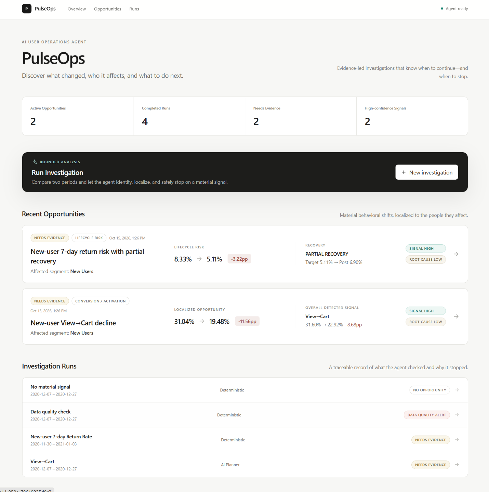
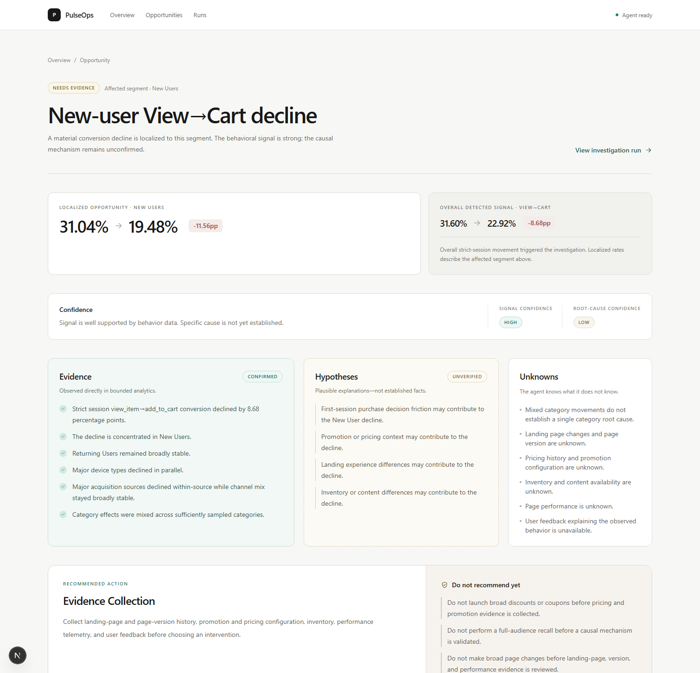
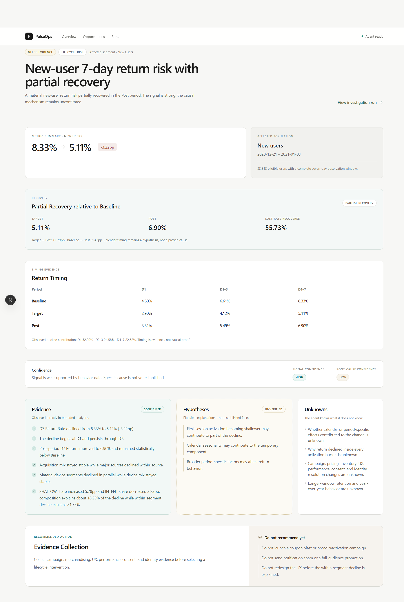
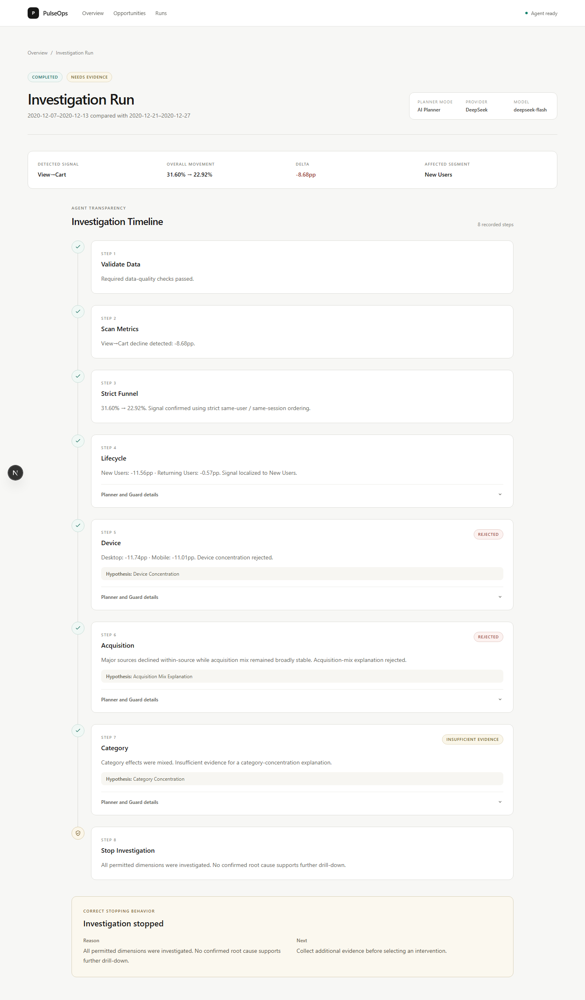
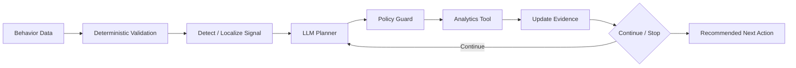
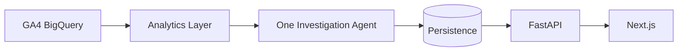

# PulseOps

> Evidence-bounded AI User Operations Agent
>
> Discover what changed, who it affects, and what to do next.

PulseOps detects meaningful changes in user behavior, identifies the affected users, investigates bounded competing explanations, and stops when the available evidence is insufficient.

It currently handles two user-operations problems: **Conversion / Activation Anomaly** and **Lifecycle Risk**. Both use the same guarded Investigation Agent, so operators can see the evidence behind a decision without turning an early signal into an unsupported intervention.

## Product Demo

### 1. Overview

See active opportunities, completed runs, evidence needs, and high-confidence signals.



### 2. Case 01 · Conversion Anomaly

An opportunity detail keeps the localized New User metric separate from the overall detected signal, then shows the resulting Evidence, Hypotheses, and Unknowns.



### 3. Case 02 · Lifecycle Risk



New-user 7-day Return Rate fell from 8.33% to 5.11%, then partially recovered to 6.90%. PulseOps kept Signal Confidence HIGH and Root-cause Confidence LOW, so the recommended action remained Evidence Collection.

### 4. Investigation Timeline

Trace which explanations the Agent checked, which were rejected, and why the investigation stopped.



## The Product Problem

When user behavior changes, product and User Operations teams need four answers:

- Is the signal real or a data-quality issue?
- Which users are actually affected?
- What evidence supports or rejects each explanation?
- When should analysis stop before intervention becomes guesswork?

Without a bounded workflow, the path is often **manual monitoring → repeated segmentation → inconsistent diagnosis → premature action**. PulseOps turns that path into a traceable, evidence-bounded decision.

## Two Real Cases

### Case 01 · New-user View→Cart decline

**Signal**

The overall strict-session View→Cart rate declined from **31.60%** to **22.92%** (**-8.68pp**) between 2020-12-07–13 and 2020-12-21–27.

**Affected Users**

The decline localized to **New Users**: **31.04% → 19.48%** (**-11.56pp**). Returning Users were broadly stable.

**Investigation**

The Agent investigated **Device**, **Acquisition**, and **Category**. None established a causal explanation.

**Decision**

| Output | Result |
| --- | --- |
| Signal Confidence | **HIGH** |
| Root-cause Confidence | **LOW** |
| Status | **NEEDS_EVIDENCE** |
| Recommended Action | **EVIDENCE_COLLECTION** |

The signal and its affected users are well supported; the root cause is not. Case 01 was independently validated against the GA4 BigQuery public dataset and with the real DeepSeek Planner. The local demo uses its verified fixture, so it does not claim to query BigQuery on every run.

### Case 02 · New-user 7-day Return Risk

**Signal**

The New-user 7-day Return Rate declined from **8.33%** to **5.11%** (**-3.22pp**, **-38.61% relative**).

**Affected Users**

New users in the target cohort, each with a complete seven-day observation window.

**Investigation**

Deterministic checks covered **Return Timing** and **Recovery**, followed by bounded investigation of **Acquisition**, **Device**, and **Activation Depth**. The decline begins at D1 and persists through D7. Acquisition mix and device concentration were rejected; an activation-depth shift was observed, but its composition explains only part of the decline. The root cause remains unconfirmed.

**Decision**

| Output | Result |
| --- | --- |
| Post-period rate | **6.90%** |
| Risk Pattern | **PARTIAL_RECOVERY** |
| Signal Confidence | **HIGH** |
| Root-cause Confidence | **LOW** |
| Status | **NEEDS_EVIDENCE** |
| Recommended Action | **EVIDENCE_COLLECTION** |

The post-period improvement is evidence of partial recovery, not proof of a causal mechanism. The investigation does not attribute the change to calendar, holiday, promotion, or reactivation effects without further evidence.

## Why this is an Agent

PulseOps uses **one Investigation Agent** across both profiles. Deterministic analytics own the facts; the LLM Planner has proposal authority over the next allowed investigation, while the Policy Guard has execution authority.

The Planner's order can change with the investigation state. Invalid, duplicate, unsafe, or premature proposals are rejected. If the provider is unavailable, deterministic fallback remains available. The Agent stops when its bounded evidence is exhausted rather than extending analysis into guesswork.



## Evidence Discipline

### Evidence

Facts confirmed by bounded Analytics Tools.

### Hypotheses

Plausible explanations that are not established facts.

### Unknowns

Information the current data cannot establish.

PulseOps is designed to know not only what it knows, but also what it does not know.

## Technical Credibility

### Architecture



| Layer | Technology |
| --- | --- |
| Backend | Python, FastAPI, SQLAlchemy, BigQuery |
| Agent | DeepSeek Planner, bounded Policy Guard, deterministic fallback |
| Frontend | Next.js, TypeScript, Tailwind CSS |
| Persistence | SQLite for local use; database layer remains portable |

### Validation

The V0.2 baseline has **116 backend tests** and **33 frontend tests** passing.

- Case 01: real BigQuery validation and real DeepSeek Planner validation
- Case 02: real BigQuery Phase A/B validation and real DeepSeek Planner validation
- Lifecycle live verification: **3 runs**, **9 proposals**, **9 accepted**, **0 rejected**, **0 fallback**, **0 illegal proposals**, **0 premature stops**, **0 unsupported causal claims**, and **0 intervention-boundary violations**
- Guard, data-quality, no-signal, transaction rollback, Product API, frontend component/API-client, and Next.js production-build coverage

Ordinary tests remain offline and never depend on DeepSeek or Google Cloud credentials. Live Planner verification is an explicit, separate check.

## Product Decisions

- **Strict same-session funnels instead of simple user-count ratios.** A valid conversion preserves user identity, session identity, and event order.
- **Signal Confidence and Root-cause Confidence are separate.** Strong evidence that a metric changed does not prove why it changed.
- **The Agent may stop.** Continuing after legal dimensions are exhausted creates noise rather than knowledge.
- **Unknown causes lead to Evidence Collection.** PulseOps does not recommend broad coupons, discounts, or page changes until missing evidence is collected.
- **The LLM cannot own business metrics.** Analytics Tools calculate facts; the Planner can only propose the next bounded investigation.

## Scope and Roadmap

### V0.1 · Conversion / Activation Anomaly ✅

- Data-quality validation and funnel anomaly detection
- Lifecycle localization and Device / Acquisition / Category investigation
- Guarded LLM Planner, evidence discipline, persistence, API, and product UI

### V0.2 · Lifecycle Risk ✅

- New-user 7-day Return Risk investigation
- Real BigQuery Phase A/B validation and live DeepSeek Planner validation

### V0.3 · Positive Growth Opportunity ☐

Planned, not implemented: detect sustained positive lifts and investigate whether they are reproducible.

### Optional · Feedback Evidence

Planned, not implemented: use linked or appropriately scoped qualitative feedback as an additional evidence source.

## Engineering Reference

### Repository Layout

```text
pulseops/backend/   Analytics, Agent, persistence, and Product API
frontend/           Next.js product experience
tests/              Golden Case, Guard, persistence, and API tests
scripts/            Safe demo seeding and manual verification scripts
outputs/            Sanitized live-planner verification reports
docs/assets/        Public product screenshots
```

### Local Development

#### Backend

Requires Python 3.11 or later.

```powershell
python -m venv .venv
.venv\Scripts\Activate.ps1
python -m pip install -r requirements.txt
uvicorn pulseops.backend.main:app --reload
```

The Product API exposes `POST /api/runs`, `GET /api/runs`, `GET /api/runs/{id}`, `GET /api/runs/{id}/steps`, `GET /api/opportunities`, and `GET /api/opportunities/{id}`. Analysis runs, bounded Agent steps, and material-signal opportunities are stored through SQLAlchemy. `DATABASE_URL` defaults to `sqlite:///./pulseops.db`; another SQLAlchemy database URL can be supplied without coupling the Agent to a particular database implementation.

#### Frontend

```powershell
cd frontend
npm install
npm run dev
```

The frontend reads the FastAPI Product API. Copy `frontend/.env.example` to `frontend/.env.local` only when the backend is not available at the configured default URL.

#### Local portfolio demo

Seed a presentation-only SQLite database under the ignored `work/` directory:

```powershell
python -m scripts.seed_demo --database-path work/pulseops-demo.db
$env:DATABASE_URL = "sqlite:///./work/pulseops-demo.db"
uvicorn pulseops.backend.main:app --host 127.0.0.1 --port 8000
```

The demo creates verified Case 01 and Case 02 material-signal runs, plus data-quality and no-signal examples. It uses verified fixture analytics and does not require cloud credentials. For Case 01 only, a configured `DEEPSEEK_API_KEY` enables the real bounded DeepSeek Planner; otherwise deterministic fallback remains available. The reset command refuses database paths outside `work/`.

### Offline Tests

The standard suites do not contact Google Cloud or DeepSeek and do not require credentials.

```powershell
python -m pytest
python -m compileall -q pulseops scripts tests

cd frontend
npm run lint
npm run typecheck
npm test
npm run build
```

### Live Integration Verification

#### BigQuery Analytics

Configure Google Application Default Credentials and a billing project, then run:

```powershell
gcloud auth application-default login
$env:GOOGLE_CLOUD_PROJECT = "your-gcp-project-id"
python -m scripts.verify_case_01 --output outputs/case_01_live.json
```

The verifier queries `bigquery-public-data.ga4_obfuscated_sample_ecommerce.events_*`, applies the New User filter to Device, Acquisition, and Category drill-downs, compares live rates with the immutable fixture using a 0.15pp default tolerance, and exits non-zero on mismatch. Without a billing project or valid credentials, it exits with a setup message without changing offline test results.

#### DeepSeek Planner

Live Planner verification is intentionally separate from ordinary tests:

```powershell
python -m scripts.verify_live_planner
python -m scripts.verify_live_lifecycle_planner
```

The scripts read `DEEPSEEK_API_KEY` only from the environment or an ignored local `.env`, write sanitized reports, and exit cleanly when the key is absent.

### Security and Privacy

- No API keys or cloud credentials are committed.
- No raw user-level data is exposed through the Product API.
- `.env`, SQLite runtime databases, caches, `node_modules`, `.next`, and `work/` are ignored.
- The local demo uses verified fixture analytics and requires no cloud credentials.
- The DeepSeek provider is optional and retains a deterministic fallback.
- Public verification reports and screenshots contain no secrets or local absolute paths.
