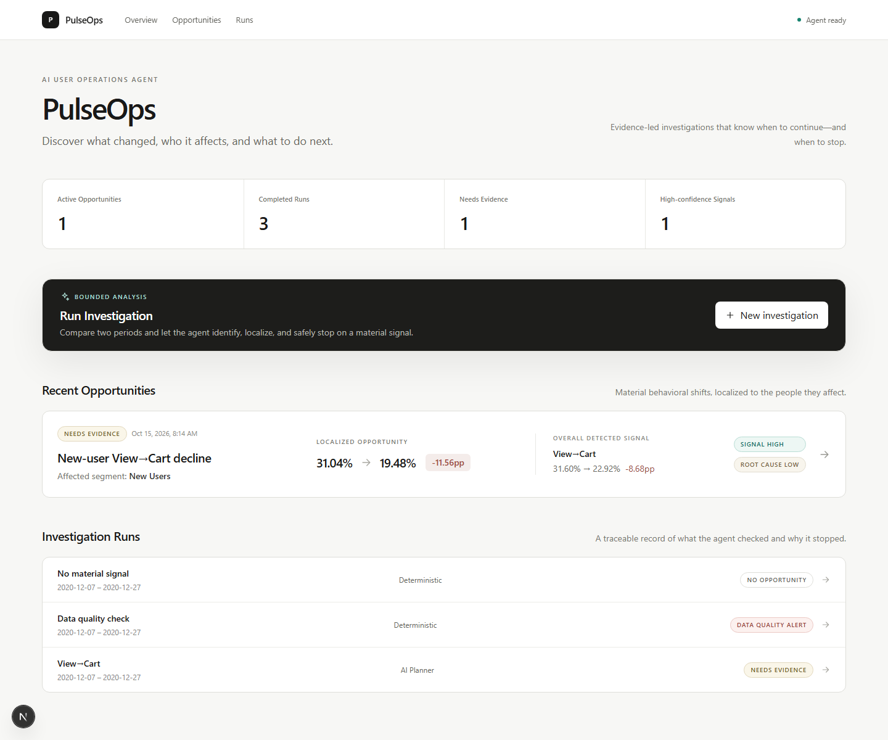
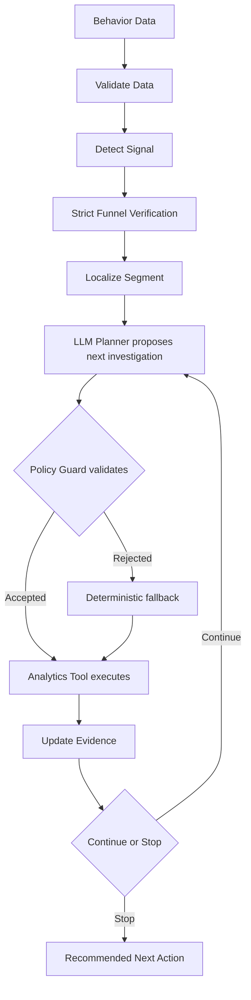
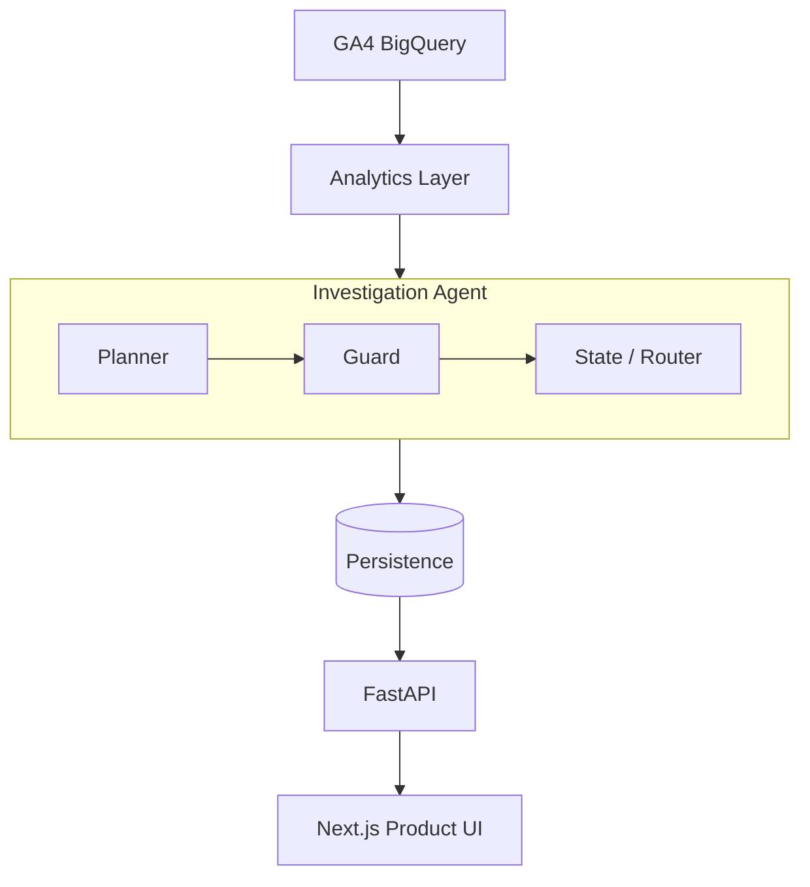

# PulseOps

> **Evidence-bounded AI User Operations Agent**
>
> Discover what changed, who it affects, and what to do next.

PulseOps is an AI user-operations agent that proactively detects meaningful behavioral shifts, localizes the affected users, investigates competing explanations with bounded analytics tools, and stops when the evidence is no longer sufficient.

Unlike a generic AI analytics assistant, PulseOps keeps **Evidence**, **Hypotheses**, and **Unknowns** separate. When the available data cannot establish a root cause, it recommends additional evidence collection instead of inventing one.

`GA4 BigQuery` · `DeepSeek Planner` · `Policy Guard` · `FastAPI` · `Next.js` · `102 automated tests`

V0.1 delivers an end-to-end conversion-opportunity investigation: verified analytics, a guarded planner, traceable run state, persistence and API layers, and a product UI for operators.

## Product Demo

### Overview

See active opportunities, completed runs, evidence needs, and high-confidence signals.



### Opportunity Detail

Separate localized opportunity metrics from the overall detected signal, while keeping Evidence, Hypotheses, and Unknowns distinct.


### Investigation Run

Trace how the Agent investigated, rejected explanations, and decided when to stop.


## Problem

Product and User Operations teams often know that a metric changed, but still need to answer:

- Is the signal real or a tracking issue?
- Which users are actually affected?
- Is the change explained by device, acquisition, or category mix?
- What is evidence versus an unverified explanation?
- When should analysis stop?
- What should be investigated before launching an intervention?

The traditional path is often:

**manual monitoring → repeated segmentation → inconsistent diagnosis → premature operational actions**

PulseOps is designed to shorten the path from seeing a metric change to reaching an evidence-bounded operational decision.

## Case 01 · New-user View→Cart decline

Case 01 uses the Google Analytics 4 public ecommerce sample in BigQuery. The comparison covers a baseline of **2020-12-07 to 2020-12-13** and a target of **2020-12-21 to 2020-12-27**.

| Scope | Baseline | Target | Change |
| --- | ---: | ---: | ---: |
| Overall strict-session View→Cart | 31.60% | 22.92% | -8.68pp |
| New Users | 31.04% | 19.48% | -11.56pp |
| Returning Users | — | — | Broadly stable |

After localizing the decline to New Users, the Agent investigated **Device**, **Acquisition**, and **Category**. Those checks did not establish a causal explanation.

| Decision output | Result |
| --- | --- |
| Signal Confidence | **HIGH** |
| Root-cause Confidence | **LOW** |
| Status | **NEEDS_EVIDENCE** |
| Recommended Action | **EVIDENCE_COLLECTION** |

The Agent confirmed what changed and who was affected, but did not fabricate a causal explanation.

Live Analytics was independently verified against BigQuery. The local portfolio demo uses a verified analytics fixture so it can run without cloud credentials; it does not claim to query BigQuery on every local run.

## How the Agent Works



### Deterministic Analytics

SQL and Python calculate the facts:

- users and sample sizes
- conversion rates
- strict funnels
- segment-level changes
- data-quality and significance checks

### LLM Planner

DeepSeek proposes:

- which allowed dimension to investigate next
- why that investigation is useful given the current state

The planner does not calculate or overwrite metrics.

### Policy Guard

The Guard prevents:

- unsupported dimensions
- duplicate investigations
- incorrect lifecycle filters
- budget violations
- premature stopping
- unsupported causal claims entering the final assessment

**The LLM has proposal authority, not execution authority.**

## Evidence Discipline

### Evidence

Facts confirmed by Analytics Tools.

> The strict same-session View→Cart rate declined by 8.68 percentage points, and the decline was concentrated in New Users.

### Hypotheses

Plausible explanations that remain unverified.

> Promotion or pricing context may contribute to the decline.

### Unknowns

Information the current dataset cannot establish.

> Promotion configuration, landing-page history, performance telemetry, and explanatory user feedback are unavailable.

**PulseOps is designed to know not only what it knows, but also what it does not know.**

## Why this is an Agent

PulseOps is not a chatbot and not a static dashboard.

The Planner observes structured investigation state, proposes the next useful investigation, passes that proposal through a Guard, invokes only bounded analytics tools, updates the shared state, and decides whether further investigation is justified. Each step is recorded so an operator can inspect what was checked, what was rejected, and why the Agent stopped.

If the provider is unavailable or its proposal is invalid, the existing deterministic planner takes over. The workflow therefore remains executable without giving the LLM direct control over analytics or business decisions.

## Architecture



| Layer | Technology |
| --- | --- |
| Backend | Python, FastAPI, SQLAlchemy, BigQuery |
| Agent | DeepSeek Planner, bounded Policy Guard, deterministic fallback |
| Frontend | Next.js, TypeScript, Tailwind CSS |
| Persistence | SQLite for local V0.1; the database layer remains portable |

### Repository Layout

```text
pulseops/backend/   Analytics, Agent, persistence, and Product API
frontend/           Next.js product experience
tests/              Golden Case, Guard, persistence, and API tests
scripts/            Safe demo seeding and manual verification scripts
outputs/            Sanitized live-planner verification reports
docs/assets/        Public product screenshots
```

## Validation

The V0.1 release has **102 automated tests passing**: 75 backend tests and 27 frontend tests.

- live validation against the GA4 public ecommerce dataset
- validation coverage across 4.29M+ events and 270k+ pseudonymous users
- Golden Case regression tests for Case 01
- five-run live DeepSeek Planner verification
- adversarial Guard tests for illegal, duplicate, mis-filtered, over-budget, and premature-stop proposals
- Data Quality Fail and No Significant Signal paths
- transaction rollback tests
- Product API tests
- frontend component and API-client tests
- successful Next.js production build

The recorded live Planner verification completed five consistent Case 01 runs without unsupported causal claims. Ordinary tests remain offline and never depend on DeepSeek or Google Cloud credentials.

## Product Decisions

- **Strict same-session funnels instead of simple user-count ratios.** A valid conversion must preserve user identity, session identity, and event order, avoiding inflated or ambiguous funnel rates.
- **Signal Confidence and Root-cause Confidence are separate.** Strong evidence that a metric changed does not prove why it changed.
- **The Agent is allowed to stop.** Continuing to segment after the legal dimensions are exhausted creates noise rather than knowledge.
- **Unknown causes lead to Evidence Collection.** PulseOps does not recommend broad coupons, discounts, or page changes until the missing evidence is collected.
- **The LLM cannot own business metrics.** Analytics Tools calculate facts; the Planner can only propose the next bounded investigation.

## Current Scope

### V0.1 · Conversion Opportunity Investigation

- [x] Data quality validation
- [x] Funnel anomaly detection
- [x] Lifecycle localization
- [x] Device / Acquisition / Category investigation
- [x] Guarded LLM Planner
- [x] Evidence / Hypotheses / Unknowns
- [x] Persistence + API
- [x] Product UI
- [x] Live DeepSeek Planner verification

## Roadmap

### V0.2 · Lifecycle Risk

Identify cohorts at risk of reduced return or engagement.

### V0.3 · Positive Growth Opportunity

Detect sustained positive lifts and investigate whether they are reproducible.

### Optional · Feedback Evidence

Use linked or appropriately scoped qualitative feedback as an additional evidence source.

Roadmap items are planned directions, not implemented V0.1 capabilities.

## Local Development

### Backend

Requires Python 3.11 or later.

```powershell
python -m venv .venv
.venv\Scripts\Activate.ps1
python -m pip install -r requirements.txt
uvicorn pulseops.backend.main:app --reload
```

The Product API exposes:

- `POST /api/runs`
- `GET /api/runs`
- `GET /api/runs/{id}`
- `GET /api/runs/{id}/steps`
- `GET /api/opportunities`
- `GET /api/opportunities/{id}`

Analysis runs, bounded Agent steps, and material-signal opportunities are stored through SQLAlchemy. `DATABASE_URL` defaults to `sqlite:///./pulseops.db`; another SQLAlchemy database URL can be supplied without coupling the Agent to a particular database implementation.

### Frontend

```powershell
cd frontend
npm install
npm run dev
```

The frontend reads the FastAPI Product API. Copy `frontend/.env.example` to `frontend/.env.local` only when the backend is not available at the configured default URL.

### Local portfolio demo

Reset and seed a presentation-only SQLite database under the ignored `work/` directory:

```powershell
python -m scripts.seed_demo --database-path work/pulseops-demo.db
$env:DATABASE_URL = "sqlite:///./work/pulseops-demo.db"
uvicorn pulseops.backend.main:app --host 127.0.0.1 --port 8000
```

The demo creates one material-signal run, one data-quality alert, and one no-signal run. It uses the verified Case 01 fixture. When `DEEPSEEK_API_KEY` is configured, only the material-signal run uses the real bounded DeepSeek Planner; otherwise the deterministic fallback remains available. The reset command refuses database paths outside `work/`.

## Offline Tests

The standard test suites do not contact Google Cloud or DeepSeek and do not require credentials.

```powershell
python -m pytest
python -m compileall -q pulseops scripts tests

cd frontend
npm run lint
npm run typecheck
npm test
npm run build
```

The Case 01 fixture reproduces the independently verified 2020-12-07–13 baseline and 2020-12-21–27 target interpretation.

## Live Integration Verification

### BigQuery Analytics

Configure Google Application Default Credentials and a billing project, then run:

```powershell
gcloud auth application-default login
$env:GOOGLE_CLOUD_PROJECT = "your-gcp-project-id"
python -m scripts.verify_case_01 --output outputs/case_01_live.json
```

The verifier queries `bigquery-public-data.ga4_obfuscated_sample_ecommerce.events_*`, applies the New User filter to Device, Acquisition, and Category drill-downs, compares live rates with the immutable fixture using a 0.15pp default tolerance, and exits non-zero on mismatch. Query dates are parameters and event names are validated before SQL generation.

Without a billing project or valid credentials, the script exits with a setup message without changing offline test results.

### DeepSeek Planner

Live Planner verification is intentionally separate from ordinary tests:

```powershell
python -m scripts.verify_live_planner
```

The script reads `DEEPSEEK_API_KEY` only from the environment or an ignored local `.env`, runs Case 01 five times, and writes sanitized reports to `outputs/m3_5_live_llm_verification.json` and `outputs/m3_5_live_llm_verification.md`. If the key is absent, it exits cleanly without affecting the offline suite.

## Security and Privacy

- No API keys or cloud credentials are committed.
- No raw user-level data is exposed through the Product API.
- `.env`, SQLite runtime databases, caches, `node_modules`, `.next`, and `work/` are ignored.
- The local demo uses verified fixture analytics and requires no cloud credentials.
- The DeepSeek provider is optional and retains a deterministic fallback.
- Public verification reports and screenshots contain no secrets or local absolute paths.

